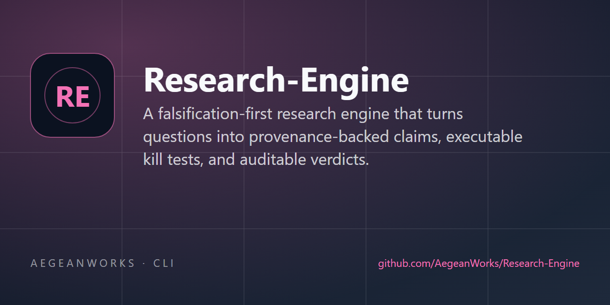

# Research Engine

<!-- aegean:media:start -->
<p align="center"></p>
<p align="center"><a href="LICENSE"></a> <a href="https://github.com/AegeanWorks/AIKit"></a></p>
<!-- aegean:media:end -->

A falsification-first research engine for provenance-backed claims, executable kill tests and auditable verdicts.

## ⚡ 30-Second Cold-Start Quick Reference

- **Runtime Prerequisites**: Rust 1.100+. Launch with `research-engine` (or `research-engine.cmd`); both build the release binary on first use. There is no Python runtime.
- **Canonical Regression Shield Gate**:
  ```bash
  cd rust && cargo test && cd .. && python -m unittest tests.test_projects_scan
  ```
- **Try it**: `research-engine demo` (synthetic, no scientific claim), then `check` and `report`.
- **Real**: see [Commands](#commands).

### 🛠️ AIKit Commands (run from the AIKit folder)
| Role | Command |
|---|---|
| Status, task and gates | `python aikit.py status research-engine` |
| Phase 4: every gate | `python aikit.py check research-engine` |
| Repair memory and map, then check | `python aikit.py fix research-engine` |
| Resume an interrupted task | `python aikit.py resume research-engine` |

## Why this is not "just lattice"

The engine is a single Rust crate with one CLI. The imported `lattice`, `studio`, `experiments`
and per-domain surfaces were consolidated into cohesive subsystems behind `run`; see
[docs/CONSOLIDATION.md](docs/CONSOLIDATION.md).

## How It Works

1. **A program is a boundary.** A research program (`research`) owns its sources, questions,
   claims, hypotheses and tests. Edges may not cross programs.
2. **Sources enter once.** A source needs a title plus a year, DOI or URL; claims cite the
   registered source, never a raw URL.
3. **Empirical claims need provenance.** `kind=empirical` needs a source, exact quote and
   locator; `kind=derived` needs a basis or premises.
4. **Hypotheses are pre-registered.** `hypothesis add` records the statement, confidence and the
   observation that would refute it at the moment of registration. Comparisons cite preregistered
   plans; uncited runs read as exploratory, corrections through amendments.
5. **Kill tests are executable and bound.** A test binds a command, declared inputs and the
   engine code to a claim or hypothesis; `test verify` requires two agreeing runs. Each run
   records command, code and input hashes, git commit and runtime, so stale evidence is
   detectable; directories are refused, declare files or globs.
6. **Verdicts are append-only and tied to evidence.** `claim verdict` records `previous -> new`,
   evidence, note, actor, time and — for `NUMERIC` — the authoritative run group it cites. A
   `NUMERIC` promotion is refused unless the claim has a test whose earliest non-replaceable
   attempt passed twice and is bound to the current code, inputs and command; `--group` pins the group.
7. **Collapse is transitive.** `claim invalidate` records the failed root and marks dependents
   `INVALIDATED`, preserving the reason in the invalidation record. `--preview-digest` binds
   the action to a `cascade preview`.
8. **Reports are generated and verifiable.** `report` and `scorecard` compute consensus,
   contradictions, gaps and audit findings. `report --out` writes a manifest with content and
   record digests; `--check` and `--strict` prove it; `export --check` proves a snapshot. No
   number is hand-written; verdict-less programs are refused.
9. **Sources can be retired.** `source status` notes concern; `source retract`
   retires every claim citing that work, twins included, and cascades.
10. **Missing evidence is explicit.** `claim verdict --status UNKNOWN` records what is missing,
    carries no weight, never promotes and never cascades.
11. **Budgeted views.** `outline`, `brief` and `claim context` report omitted lines.
12. **Duplicates merge; refinements revise.** `claim merge` repoints edges and bound tests to
    the survivor and records duplicates as RETRACTED. `claim revise` supersedes the old claim,
    moves its edges to the new head, and starts untested; old verdicts stay visible.
13. **A test must be able to fail.** `test add --control CMD` declares a reproducibly-failing
    negative control. A verified test without a control warns (`EVID-008`); a control that
    never fails errors (`EVID-009`).
14. **Sources are screened.** `source screen` moves a source through the lifecycle with a
    closed-taxonomy reason; `source prisma` shows the flow, and citing an excluded source
    warns (`SCREEN-001`).
15. **Measurements are recorded, not retyped.** `observation add` stores each value in a named
   group with instrument, rater, protocol and unit. Incomparable groups need
   `--allow-incomparable`; `--provenance-class self_reported` quarantines a system number.
   `observation void` retires one with a reason (`OBS-001`..`OBS-004` warn).
16. **Every non-verdict action is logged.** Status changes, screening, merges, reports and
    migrations append to a hash-chained log; `events --verify` checks continuity,
    `events --tree`/`--path` render causality.
17. **Discovery is lexical and bounded.** `search` ranks records by exact phrase then matched
    terms and packs text to `--budget`; `source duplicates` groups DOI/title matches and
    `DUP-002` warns on a hard duplicate.
18. **Confidence is scored, not just stored.** `analysis calibration` computes Brier, log loss,
    reliability bins, coverage and a baseline skill score from preregistered confidence and
    recorded outcomes; a small resolved set is labelled descriptive.

## Verdict Vocabulary

| Status | Meaning | Requirements |
|---|---|---|
| `UNVERIFIED` | Recorded, not yet adjudicated | provenance rules for its kind |
| `PROVEN` | An argument establishes it | kill test + evidence-backed verdict |
| `UNKNOWN` | The evidence does not exist | evidence naming what is missing; zero consensus weight |
| `NUMERIC` | A reproducible measurement establishes it | kill test + evidence + a test that passed twice with identical output, bound to the current code, inputs and command; the verdict cites that run group |
| `FALSIFIED` | Evidence contradicts it | evidence-backed verdict |
| `RETRACTED` | The author withdraws it, or its only source was retracted | evidence-backed verdict |
| `INVALIDATED` | A premise collapsed; this claim was not independently re-established | cascade record |

`PROVEN` means "the evidence path is recorded and the kill test is named"; it is not a
machine-checked formal proof. The engine's job is to keep the record honest, not to replace the
researcher's judgment.

## Commands

The canonical and only runtime is the Rust binary (`research-engine`). Every capability below is
implemented in `rust/src`; there is no Python entry point. The command tree is authoritative via
`research-engine --help` and `research-engine <command> --help`.

```text
research-engine [--db PATH] [--json] init | demo | check | inventory | report | scorecard | outline | brief | events | diff | export
research-engine [--db PATH] [--json] search QUERY [--research REF] [--kind KIND]...
research-engine [--db PATH] research add LIST | show REF
research-engine [--db PATH] question add | list | close
research-engine [--db PATH] source add | list | status | screen | retract | prisma | duplicates
research-engine [--db PATH] protocol add | list | amend
research-engine [--db PATH] observation add | list | void | import-csv
research-engine [--db PATH] claim add | list | show | revise | merge | link | link-question | verdict | history | context | invalidate
research-engine [--db PATH] hypothesis add | list | card | amend | outcome
research-engine [--db PATH] test add | list | run | verify | runs | attempts
research-engine [--db PATH] cascade preview
research-engine [--db PATH] analysis stats | stats-all | trend | calibration | contradictions | matrix | keystone | expose | correlation | plan
research-engine [--db PATH] db integrity | backup
research-engine [--db PATH] ai sweep | extract | idea | propose-test | draft | artifacts
research-engine [--db PATH] experiment ...
```

The unified `run` entry point carries the engine's important capabilities:

```text
research-engine run analyze --input FILE
research-engine run execute <capability> --input '{...}'
```

`run execute` capabilities are grouped into four subsystems: `catalog.*` (literature identity),
`candidate.*` (design rules, screening, safety), `bridge.primitives` (Gaussian/fluid primitives)
and `corpus.*` (bibliography parsing and duplicate-source detection). See
[rust/README.md](rust/README.md) for the full capability vocabulary.

## Integrity Gate

`research-engine check` audits:

- empirical claims missing a source, quote or locator (`PROV-001`);
- sources with no year, DOI or URL (`PROV-002`);
- promoted claims without a kill test or evidence-backed verdict (`EVID-001`);
- numeric claims without a two-run agreeing test (`EVID-002`);
- numeric claims whose verified run no longer matches the current engine code, inputs or command (`EVID-005`);
- one missing evidence volume shared by 3 or more stale claims (`EVID-011`);
- numeric claims citing a non-authoritative verdict group (`EVID-006`);
- failed/invalidated claims without verdict evidence (`EVID-003`);
- hypothesis outcomes without verdict evidence (`EVID-004`);
- claims citing a retracted source (`PROV-003`) or one under concern (`PROV-004`, warning);
- dependency cycles (`GRAPH-001`), dangling edges (`GRAPH-002`), self edges (`GRAPH-003`),
  support cycles (`GRAPH-004`, warning);
- cross-program edges (`SCOPE-001`);
- dependents left standing after a failed premise (`CASCADE-001`);
- outcome timestamps before registration (`PRE-001`);
- evidence gaps (`GAP-001`, `GAP-002`), duplicate claim text (`DUP-001`, live only), empty programs (`EMPTY-001`);
- duplicate source identity (`DUP-002`, warning);
- a verified test without a negative control (`EVID-008`, warning) or whose control never failed (`EVID-009`, error);
- a live quote restating a question, duplicating another quote, or empty (`EVID-010`, warning);
- observations with missing or stale statistics (`OBS-001`, warning);
- observations with no instrument, rater or protocol (`OBS-002`, warning);
- observations not classified as independent or self-reported (`OBS-003`, warning), and self-reported observations quarantined from independent comparisons (`OBS-004`, warning);
- a live claim citing a screened-out source (`SCREEN-001`, warning);
- a test bound to a retired (`TEST-001`, warning) or superseded (`REV-002`, warning) claim, or a dependent pointing at a superseded claim (`REV-001`, warning);
- a test created after another test on the same claim failed (`TEST-002`, warning);
- an UNKNOWN claim with no recorded reason (`EVID-007`, warning).
- AI provenance: an unresolvable AI citation (`AI-001`), an AI-origin claim proven without a twice-passing test (`AI-002`), an AI test off its fixed template (`AI-003`).
- a broken event hash chain (`LEDGER-001`);
- a corrupt schema ledger (`SCHEMA-001`).

Warnings are research hygiene; errors block a trustworthy report.

## Data Model

One SQLite file (default `research.db`), schema version 14. Tables: `research`, `source`,
`question`, `claim`, `edge`, `hypothesis`, `killtest`, `test_run`, `test_attempt`, `verdict`,
`invalidation`, `observation`, `protocol`, `ai_artifact`, `event`, `analysis_plan`,
`amendment`, `experiment_intervention`, `experiment_metric_definition`, `experiment_metric`,
`experiment_event`, `domain_pack`, `migration_run`. `source`
adds paper metadata (`arxiv`, `venue`, `abstract`, `tags`, `study_type`); `claim`
carries `revision_of`, `superseded_by`, `revision_reason`; revisions are new rows.
`migration_run` deduplicates a source snapshot by SHA-256.
`observation` carries its instrument, rater and protocol. `event` carries `seq`, `root_id`,
`parent_id`, `prev_hash`, `event_hash`.
Verdicts, runs, events, observations and amendments are append-only. See
[docs/ARCHITECTURE.md](docs/ARCHITECTURE.md).

## Non-Negotiables

- No empirical claim without a source, exact quote and locator.
- No promotion without a named kill test and an evidence path.
- No NUMERIC verdict without two agreeing runs; a single run is recorded as evidence, not proof.
- The earliest non-replaceable attempt is authoritative; a later pass cannot displace an earlier
  subject failure. A promotion cites a current verified run group and current code, inputs and
  command; stale evidence is an error, not a pass.
- Retracting a source retires its claims across twin rows; a live claim citing one is an error.
- A committed report is only valid alongside its manifest, and `report --check` must stay clean.
- Negative results are kept; corrections are new verdicts.
- A revision starts untested; verdicts are not inherited.
- A failed claim is revived only by a revision.
- A superseded claim accepts no new verdict, measurement, test, edge or premise.
- A comparison across different protocols, instruments or units is refused unless explicitly
  allowed.
- A self-reported measurement is listed separately and needs a caveat to compare.
- A failed premise invalidates its dependents; a report with `CASCADE-001` is not trustworthy.
- Reports and scorecards are generated from the graph.
- The engine has no undeclared inputs and makes no network calls.

## What's Inside

```text
research-engine/
├── .aikit/             <- project memory: ledger, decisions, guidelines
├── .gitattributes      <- LF line endings for tracked text
├── .gitignore
├── ASSETS.md           <- data and asset manifest
├── COMMERCIAL.md
├── LICENSE             <- Aegean Science License 1.1 (ASL-1.1)
├── LICENSES/
├── REUSE.toml
├── README.md
├── assets/             <- logo and social preview images
├── docs/               <- architecture, consolidation, merge pins and readiness
├── rust/               <- the complete Rust engine (single crate, single CLI)
├── tests/              <- the project-scan coverage test
├── research-engine     <- canonical Rust runtime launcher (POSIX)
└── research-engine.cmd <- canonical Rust runtime launcher (Windows)
```

## Rust implementation

`rust/` is the canonical implementation of every command: schema and migrations, integrity,
provenance, verdicts, cascade, screening, analysis, statistics, AI artifacts, the lattice catalog
and the four consolidated engine subsystems. The Python runtime and its tests were removed under
ADR-064; the binary writes the same schema-14 graph and takes the same global `--db`/`--json`
flags. Build with `cd rust && cargo build`, test with `cargo test`. See
[rust/README.md](rust/README.md).

## Deliberate Limits

- **No literature crawling.** Sources are registered explicitly.
- **Single writer.** One researcher or agent at a time.
- **Consensus is a display heuristic, not a posterior; UNKNOWN contributes zero.**
- **Search is lexical.** Exact phrase first, then matched terms.
- **Calibration is descriptive.** Small resolved sets read descriptive.
- **Discovery is advisory; only `claim link` records a relation.**
- **Statistics describe recorded numbers; independence is assumed.**
- **Rank tests are exact for untied small samples, tie-corrected otherwise.**
- **`--holm` adds a display-only cross-claim Holm table.**
- **A control proves falsifiability, not correctness.**
- **Screening is local; correctness is not verified.**
- **Views are summaries.** Omitted lines are counted; never an empty view.
- **Judgment stays in the loop.** Tests never auto-promote.
- **Undeclared inputs are invisible.** Only declared `--input` paths are bound.

<!-- aegean:brand-assets:start -->
## 🎨 Brand Assets

> **AI-Generated Brand Artwork.** The banner and logo are **AI-generated brand assets**. They are illustrative and may not literally depict every feature or the full project scope.
<!-- aegean:brand-assets:end -->

## 📜 License

Free for non-commercial research and teaching under the Aegean Science License 1.1 (ASL-1.1); see [LICENSE](LICENSE). It allows publication, reproducibility sharing, text/data mining and non-commercial ML training. Commercial or industry-sponsored use needs the Aegean Commercial License 1.0 (ACL-1.0); see [COMMERCIAL.md](COMMERCIAL.md).
