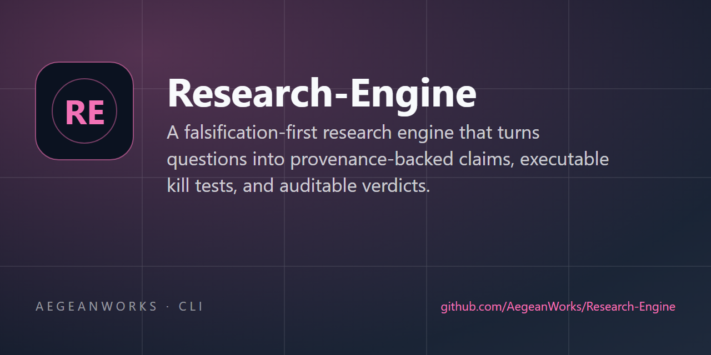

# Research Engine

<!-- aegean:media:start -->
<p align="center"></p>
<p align="center"><a href="LICENSE"></a> <a href="https://github.com/AegeanWorks/AIKit"></a></p>
<!-- aegean:media:end -->

A falsification-first research engine for provenance-backed claims, executable kill tests and auditable verdicts.

## ⚡ 30-Second Cold-Start Quick Reference

- **Runtime Prerequisites**: Python 3.10+; standard library only, no network or third-party packages.
- **Canonical Regression Shield Gate**:
  ```bash
  python -m unittest discover -s tests -t .
  ```
- **Try every mechanic in 10 seconds**:
  ```bash
  python -m engine demo
  python -m engine check
  python -m engine report r_000001
  ```
  `demo` builds a labelled synthetic program and makes no scientific claim.
- **Start a real program**: see [Commands](#commands) for `research`, `question`, `source` and
  `claim add`.

### 🛠️ AIKit Commands (run from the AIKit folder)
| Role | Command |
|---|---|
| Status, task and gates | `python aikit.py status research-engine` |
| Phase 4: every gate | `python aikit.py check research-engine` |
| Repair memory and map, then check | `python aikit.py fix research-engine` |
| Resume an interrupted task | `python aikit.py resume research-engine` |

## Why this is not "just lattice"

`lattice` is a strong evidence store but not a research lifecycle. The engine borrows its
provenance rule and adds what a claim is allowed to mean. The clean-room mechanics come from
`lattice`, `fluid-universe`, `obezite-mekanizma-projesi`, `PNN`, `N1-Engine` and
`aegean-licensing`; [docs/MECHANICS.md](docs/MECHANICS.md) records each adopted rule and what was
deliberately not copied. Domain content stays in the programs the engine hosts.

## How It Works

1. **A program is a boundary.** A research program (`research`) owns its sources, questions,
   claims, hypotheses and tests. Edges may not cross programs.
2. **Sources enter once.** A source needs a title and at least one of year, DOI or URL. Claims
   cite the registered source, never a raw URL.
3. **Empirical claims need provenance.** `kind=empirical` refuses to save unless a source, an
   exact quote and a locator are present. `kind=derived` needs a basis or premise claims.
4. **Hypotheses are pre-registered.** `hypothesis add` records the statement, confidence and the
   observation that would refute it at the moment of registration. The outcome is recorded later
   and is append-only.
5. **Kill tests are executable and bound.** A test binds a command, declared inputs and the
   engine code to a claim or hypothesis. `test verify` runs it twice and requires the same exit
   code and output hashes. Each run records the command, code and input hashes, git commit and
   runtime, so stale evidence is detectable. A directory is refused as an input; declare files or
   a glob.
6. **Verdicts are append-only and tied to evidence.** `claim verdict` records `previous -> new`,
   evidence, note, actor, time and — for `NUMERIC` — the authoritative run group it cites. A
   `NUMERIC` promotion is refused unless the claim has a test whose earliest non-replaceable
   attempt passed twice and is bound to the current code, inputs and command; `--group` pins the
   authoritative group.
7. **Collapse is transitive.** `claim invalidate` records the failed root and marks every claim
   that depends on it as `INVALIDATED`, with the reason preserved in the invalidation record.
8. **Reports are generated and verifiable.** `report` and `scorecard` compute consensus,
   contradictions, gaps and audit findings from the graph. `report --out` also writes a manifest
   with a content digest, an exact record digest, the report digest, counts, findings and limits.
   `report --check` compares content; `--strict` compares exact records. An export carries its own
   digest, so `export --check` proves a snapshot intact and refuses an unread schema. No number is
   hand-written.
9. **Sources can be retired.** `source status` records an expression of concern; `source retract`
   retires every claim that cites the source and cascades to their dependents.
10. **Missing evidence is explicit.** `claim verdict --status UNKNOWN` records that the evidence
    does not exist and why. UNKNOWN has zero consensus weight, never promotes a dependent, and
    is never treated as a failure that would cascade.
11. **The graph is readable under a budget.** `outline` gives one line per question, hypothesis
    and test; `brief` gives the strongest support and contradiction per question; `claim context`
    gives one claim with provenance, premises and history. Each states its omitted line count.
12. **Duplicates merge; refinements revise.** `claim merge KEEP DUP...` repoints every edge and
    bound test to the survivor and records each duplicate as RETRACTED. `claim revise` appends a
    revision, marks the old claim superseded and moves its edges to the new head; old verdicts stay
    visible through `claim history`, and the new claim starts untested.
13. **A test must be able to fail.** `test add --control CMD` declares a negative control that
    must fail reproducibly. A test that has produced verified evidence without a control is a
    warning (`EVID-008`); a declared control that does not fail is an error (`EVID-009`).
14. **Sources are screened, not just stored.** `source screen` moves a source through
    `identified`, `screened_in`/`screened_out` and `included`/`excluded`, with a reason from a
    closed taxonomy. `source prisma` and the report show the flow; a claim citing an excluded
    source warns (`SCREEN-001`).
15. **Measurements are recorded, not retyped.** `observation add` stores each value in a named group; with `--instrument-*`, `--rater-*` and `--protocol` it also stores what produced the number, and `analysis stats` refuses to compare different protocols, instruments or units unless `--allow-incomparable` is explicit. `--provenance-class self_reported` quarantines a number produced by the system under study; reports list it separately and comparisons require `--allow-self-reported`. `observation void` retires one with a reason. A claim with observations but no statistics run warns (`OBS-001`), an unprovenanced observation warns (`OBS-002`), and an unclassified or self-reported observation warns (`OBS-003`/`OBS-004`).
16. **Every non-verdict action is logged.** Source status changes, screening, merges, report
    generation and schema migration append to an event log with a per-program sequence and an
    optional parent, so `events --tree` and `events --path` can render the causal chain. Verdicts
    keep history.

## Verdict Vocabulary

| Status | Meaning | Requirements |
|---|---|---|
| `UNVERIFIED` | Recorded, not yet adjudicated | provenance rules for its kind |
| `PROVEN` | An argument establishes it | kill test + evidence-backed verdict |
| `UNKNOWN` | The evidence does not exist | evidence naming what is missing; zero consensus weight |
| `NUMERIC` | A reproducible measurement establishes it | kill test + evidence + a test that passed twice with identical output, bound to the current code, inputs and command; the verdict cites that run group |
| `FALSIFIED` | Evidence contradicts it | evidence-backed verdict |
| `RETRACTED` | The author withdraws it, or its only source was retracted | evidence-backed verdict |
| `INVALIDATED` | A premise collapsed; this claim was not independently re-established | cascade record |

`PROVEN` means "the evidence path is recorded and the kill test is named"; it is not a
machine-checked formal proof. The engine's job is to keep the record honest, not to replace the
researcher's judgment.

## Commands

```text
python -m engine [--db PATH] [--json] init
python -m engine [--db PATH] [--json] demo
python -m engine [--db PATH] [--json] check
python -m engine [--db PATH] [--json] inventory

python -m engine [--db PATH] research add TITLE [--scope TEXT] [--slug SLUG]
python -m engine [--db PATH] research list
python -m engine [--db PATH] research show REF

python -m engine [--db PATH] question add RESEARCH TEXT
python -m engine [--db PATH] question list [--research REF]
python -m engine [--db PATH] question close REF

python -m engine [--db PATH] source add RESEARCH --title TITLE [--year Y] [--doi DOI] [--url URL]
python -m engine [--db PATH] source list [--research REF]
python -m engine [--db PATH] source status REF --status active|expression_of_concern|retracted [--note TEXT]
python -m engine [--db PATH] source screen REF --status identified|screened_in|screened_out|included|excluded [--reason R]
python -m engine [--db PATH] source prisma [--research REF]
python -m engine [--db PATH] source retract REF --reason TEXT --evidence TEXT

python -m engine [--db PATH] protocol add --id ID --measures TEXT [--includes-generation]
                        [--includes-judge] [--doc-digest SHA256]
python -m engine [--db PATH] protocol list

python -m engine [--db PATH] observation add CLAIM --group LABEL --value F [--note TEXT]
                        [--instrument-kind K] [--instrument-id ID] [--instrument-digest SHA256]
                        [--rater-kind K] [--rater-id ID] [--rater-version V]
                        [--protocol ID] [--sample-size N] [--aggregation METHOD] [--unit U]
                        [--provenance-class independent|self_reported|unclassified]
                        [--producer-path PATH] [--producer-digest SHA256]
python -m engine [--db PATH] observation list CLAIM [--group LABEL] [--include-voided]
python -m engine [--db PATH] observation void OBS --reason TEXT

python -m engine [--db PATH] claim add RESEARCH --text TEXT --kind KIND [--source REF]
                        [--quote TEXT] [--locator TEXT] [--confidence C] [--kill-test TEXT]
                        [--basis TEXT] [--from CLAIM]...
python -m engine [--db PATH] claim list [--research REF] [--status STATUS] [--history]
python -m engine [--db PATH] claim revise REF --text TEXT --reason TEXT [--source REF]
                        [--quote TEXT] [--locator TEXT] [--confidence C] [--kill-test TEXT]
                        [--basis TEXT] [--from CLAIM]...
python -m engine [--db PATH] claim history REF
python -m engine [--db PATH] claim show REF
python -m engine [--db PATH] claim link SRC DST --rel REL
python -m engine [--db PATH] claim link-question CLAIM QUESTION --stance STANCE
python -m engine [--db PATH] claim verdict REF --status STATUS --evidence TEXT [--note TEXT] [--group GROUP]
python -m engine [--db PATH] claim invalidate REF --status FALSIFIED|RETRACTED --reason TEXT --evidence TEXT
python -m engine [--db PATH] claim merge KEEP DUP... [--note TEXT]
python -m engine [--db PATH] claim context REF [--budget N]

python -m engine [--db PATH] hypothesis add RESEARCH --statement TEXT --criterion TEXT
                        [--confidence C] [--question REF]
python -m engine [--db PATH] hypothesis list [--research REF]
python -m engine [--db PATH] hypothesis outcome REF --status SUPPORTED|REFUTED|INCONCLUSIVE --evidence TEXT
python -m engine [--db PATH] hypothesis card REF

python -m engine [--db PATH] test add RESEARCH --name NAME --command CMD [--claim REF]
                        [--hypothesis REF] [--expect-exit N] [--timeout SECONDS] [--input PATH]...
                        [--control CMD]
python -m engine [--db PATH] test list [--research REF]
python -m engine [--db PATH] test run REF [--runs N]
python -m engine [--db PATH] test verify REF
python -m engine [--db PATH] test runs [REF] [--limit N]
python -m engine [--db PATH] test attempts [REF] [--limit N]

python -m engine [--db PATH] cascade preview REF
python -m engine [--db PATH] report REF [--out PATH]
python -m engine [--db PATH] report REF --check PATH [--strict]
python -m engine [--db PATH] outline REF [--budget N]
python -m engine [--db PATH] brief REF [--budget N]
python -m engine [--db PATH] analysis contradictions REF [--min-score S] [--unlinked]
python -m engine [--db PATH] analysis matrix REF
python -m engine [--db PATH] analysis keystone REF [--limit N]
python -m engine [--db PATH] analysis expose REF
python -m engine [--db PATH] analysis stats CLAIM --baseline LABEL --treatment LABEL [--seed N] [--resamples N] [--allow-incomparable] [--allow-self-reported]
python -m engine [--db PATH] analysis trend CLAIM --group LABEL
python -m engine [--db PATH] diff OLD.jsonl NEW.jsonl [--exact]
python -m engine [--db PATH] db integrity
python -m engine [--db PATH] db backup PATH
python -m engine [--db PATH] events [--research REF] [--kind K] [--limit N]
python -m engine [--db PATH] events --tree ROOT
python -m engine [--db PATH] events --path EVENT
python -m engine [--db PATH] scorecard REF
python -m engine [--db PATH] export PATH [--research REF] [--check]
```

`--json` prints stable machine-readable payloads. `check` exits 1 when any error-level finding is
present and 0 when only warnings remain. Domain errors print the `Error / Why / Fix` triad and exit 1.

## Integrity Gate

`python -m engine check` audits:

- empirical claims missing a source, quote or locator (`PROV-001`);
- sources with no year, DOI or URL (`PROV-002`);
- promoted claims without a kill test or evidence-backed verdict (`EVID-001`);
- numeric claims without a two-run agreeing test (`EVID-002`);
- numeric claims whose verified run no longer matches the current engine code, declared inputs or
  command (`EVID-005`);
- numeric claims whose promotion verdict cites a group that is not authoritative (`EVID-006`);
- failed or invalidated claims without verdict evidence (`EVID-003`);
- hypothesis outcomes without verdict evidence (`EVID-004`);
- claims that still cite a retracted source (`PROV-003`) or one under an expression of concern
  (`PROV-004`, warning);
- dependency cycles (`GRAPH-001`), dangling edges (`GRAPH-002`), self edges (`GRAPH-003`);
- edges that cross program boundaries (`SCOPE-001`);
- dependents left standing after a premise failed (`CASCADE-001`);
- outcome timestamps before registration (`PRE-001`);
- evidence gaps (`GAP-001`, `GAP-002`), duplicate claim text (`DUP-001`, live claims only),
  empty programs (`EMPTY-001`);
- a test that produced verified evidence without a negative control (`EVID-008`, warning) or
  whose declared control never failed (`EVID-009`, error);
- a live quote that restates a linked question, duplicates another live quote, or has no content
  terms (`EVID-010`, warning);
- observations with no statistics run, or changed after the last one (`OBS-001`,
  warning);
- observations with no instrument, rater or protocol (`OBS-002`, warning);
- observations not classified as independent or self-reported (`OBS-003`, warning), and
  self-reported observations quarantined from independent comparisons (`OBS-004`, warning);
- a live claim citing a source screened out of the review (`SCREEN-001`, warning);
- a test still bound to a retired claim (`TEST-001`, warning), to a superseded claim
  (`REV-002`, warning), or a dependent still pointing at a superseded claim (`REV-001`, warning);
- a test created after another test on the same claim failed (`TEST-002`, warning);
- an UNKNOWN claim with no recorded reason (`EVID-007`, warning).

Warnings are research hygiene; errors block a trustworthy report.

## Data Model

One SQLite file (default `research.db`), schema version 10. Tables: `research`, `source`,
`question`, `claim`, `edge`, `hypothesis`, `killtest`, `test_run`, `test_attempt`, `verdict`,
`invalidation`, `observation`, `protocol`, `event`, plus `schema_meta` and `counters`. `claim`
carries `revision_of`, `superseded_by` and `revision_reason`; a revision is a new row, never an
edit. `observation` carries the instrument, rater, protocol, sample size, aggregation, unit and
provenance class recorded with the value. `event` carries a per-program `seq`, `root_id` and
`parent_id`. Writes use `BEGIN IMMEDIATE`; WAL and `synchronous=FULL` are enabled for a durable
state file. `verdict`, `test_run`, `test_attempt`, `event`, `observation` and `invalidation` are
append-only (an observation is voided, never edited or deleted). `export` includes attempts,
observations, protocols and the event log; the manifest digests cover evidence records and
exclude the log.
See [docs/ARCHITECTURE.md](docs/ARCHITECTURE.md).

## Non-Negotiables

- No empirical claim without a source, exact quote and locator.
- No promotion without a named kill test and an evidence path.
- No NUMERIC verdict without two agreeing runs; a single run is recorded as evidence, not proof.
- The earliest non-replaceable attempt is authoritative; a later pass cannot displace an earlier
  subject failure.
- A NUMERIC promotion must cite a current verified run group; there is no promotion without one.
- Numeric evidence must still match the current engine code, declared inputs and command; stale
  evidence is an error, not a pass.
- A retracted source retires the claims that cite it; a live claim citing one is an error.
- A committed report is only valid alongside its manifest, and `report --check` must stay clean.
- Negative results are kept; corrections are new verdicts.
- A revision starts untested; verdicts are not inherited.
- A failed claim is revived only by a revision.
- A superseded claim accepts no new verdict, measurement, test, edge or premise.
- A comparison across different protocols, instruments or units is refused unless explicitly
  allowed.
- A self-reported measurement is listed separately and needs a caveat to compare.
- A failed premise invalidates its dependents; a report with `CASCADE-001` is not trustworthy.
- Reports and scorecards are generated from the graph.
- The engine is standard library only and makes no network calls. Sources are explicit.

## What's Inside

```text
research-engine/
├── .aikit/                   <- project memory: ledger, decisions, guidelines
├── .gitignore
├── assets/                   <- logo and social preview images
├── ASSETS.md                 <- data and asset manifest
├── COMMERCIAL.md
├── LICENSE                   <- Aegean Science License 1.1 (ASL-1.1)
├── LICENSES/
├── REUSE.toml
├── README.md
├── docs/
│   ├── ARCHITECTURE.md       <- layers, schema, transactions, extension points
│   └── MECHANICS.md          <- reference mechanics and their clean-room rules
├── engine/
│   ├── __init__.py
│   ├── __main__.py           <- `python -m engine`
│   ├── analysis.py           <- contradictions, coverage matrix, keystones
│   ├── artifacts.py          <- timestamps, output digests and atomic writes
│   ├── attempts.py           <- append-only kill-test attempts and authority
│   ├── bundle.py             <- deterministic JSONL export
│   ├── cascade.py            <- transitive invalidation
│   ├── claims.py             <- provenance rules, verdicts, edges
│   ├── cli.py                <- one parser and dispatch surface
│   ├── context.py            <- token-budgeted outline, brief and claim views
│   ├── database.py           <- connection, schema, transactions, IDs
│   ├── demo.py               <- synthetic golden path
│   ├── diffing.py            <- snapshot comparison
│   ├── events.py             <- append-only action log
│   ├── errors.py             <- Error / Why / Fix
│   ├── evidence.py           <- run binding and current verified groups
│   ├── hypotheses.py         <- pre-registration and outcomes
│   ├── information.py        <- cheap quote information checks
│   ├── integrity.py          <- the check gate
│   ├── killtests.py          <- executable tests, binding and two-run verification
│   ├── maintenance.py        <- integrity check and verified backup
│   ├── manifest.py           <- report manifests and drift checks
│   ├── markdown.py           <- safe rendering of untrusted text
│   ├── merging.py            <- duplicate claim merge
│   ├── models.py             <- frozen DTOs and closed vocabularies
│   ├── provenance.py         <- code and input identity recorded with evidence
│   ├── protocols.py          <- immutable measurement protocol registry
│   ├── observations.py       <- recorded measurements per claim group
│   ├── questions.py
│   ├── researches.py
│   ├── screening.py          <- screening decisions and PRISMA flow
│   ├── sources.py
│   ├── stats.py              <- deterministic tests, effect size, bootstrap
│   └── synthesis.py          <- consensus, report, scorecard
└── tests/                    <- regression shield plus a full golden run
```

## Deliberate Limits

- **No literature crawling.** Sources are registered explicitly.
- **Single writer.** One researcher or agent at a time.
- **Consensus is a display heuristic.** It is not a posterior and never changes a verdict;
  UNKNOWN contributes zero.
- **Discovery is advisory.** `analysis` proposes; only `claim link` records a relation.
- **Statistics describe the recorded numbers, not the world.** Independence is assumed.
- **Rank-test method is stated.** Exact for untied small samples, tie-corrected approximation
  otherwise.
- **Multiple comparisons are flagged, not corrected.** P-values are not adjusted.
- **A control proves falsifiability, not correctness.** It shows the test can fail, not that the
  assertion is right.
- **Screening is local.** States are recorded; correctness is not verified.
- **Views are summaries.** Omitted lines are counted; the anchor line is kept, so a tiny budget
  yields one over-budget line, never an empty view.
- **Human judgment stays in the loop.** Tests produce evidence; they never auto-promote.
- **Undeclared inputs are invisible.** Evidence binds the engine code and declared `--input` paths;
  an undeclared read is unseen.

<!-- aegean:brand-assets:start -->
## 🎨 Brand Assets

> **AI-Generated Brand Artwork.** The banner and logo are **AI-generated brand assets**. They are illustrative and may not literally depict every feature or the full project scope.
<!-- aegean:brand-assets:end -->

## 📜 License

Free for non-commercial research and teaching under the Aegean Science License 1.1 (ASL-1.1); see [LICENSE](LICENSE). It allows publication, reproducibility sharing, text/data mining and non-commercial ML training. Commercial or industry-sponsored use needs the Aegean Commercial License 1.0 (ACL-1.0); see [COMMERCIAL.md](COMMERCIAL.md).
